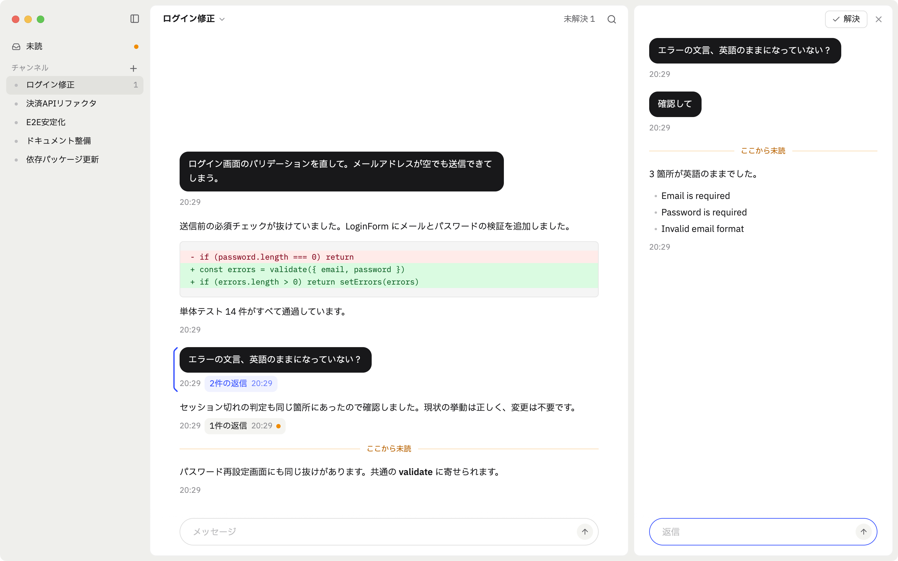
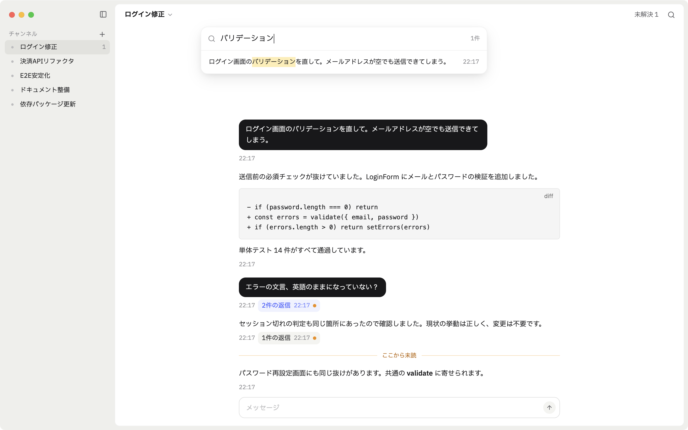
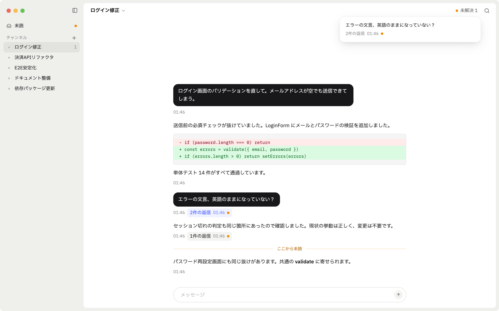

# Braydr

コーディングエージェントとのやり取りを、Slack 風のタイムラインとスレッドで行う macOS アプリ。
エージェントの実行は [herdr-core](https://github.com/herdrdev/herdr-core) に任せる。



<table>
  <tr>
    <td></td>
    <td></td>
  </tr>
</table>

## 文書

- [`docs/product-spec.md`](docs/product-spec.md): 機能、条件、データ、API
- [`docs/design-system.md`](docs/design-system.md): 見た目と文言。画面は `design/braydr.pen`
- [`docs/architecture.md`](docs/architecture.md): 技術選定、構成、テスト、検証結果
- [`docs/manual-checks.md`](docs/manual-checks.md): 自動化できない確認

## 使い方

前提は Apple Silicon の macOS、Rust（stable）、`~/.local/bin` か `PATH` 上の `hc`。

```sh
scripts/bundle.sh                 # target/release/Braydr.app を作る
open target/release/Braydr.app
```

`cargo run -p braydr-app` でも動くが、macOS の通知は `.app` からしか出ない。

### エージェントの設定

スキルと MCP はハーネスごとに設定方法が違うので、アプリは設定しない。Claude Code の場合は次のとおり。

```sh
claude mcp add --scope user braydr -- "$PWD/target/release/Braydr.app/Contents/MacOS/braydr-mcp"
mkdir -p ~/.claude/skills && cp -R skills/braydr ~/.claude/skills/
```

初めて開くディレクトリでは Claude Code が信頼の確認で止まる。チャンネルの作成前に一度 `claude` を
そのディレクトリで起動して承認するか、`hc attach <session>` で開いて承認する。止まっている間の投稿は
セッションに送らず、承認後にエージェントが履歴から読む。

アプリのデータは `~/Library/Application Support/Braydr/` に置く。

## 開発

```sh
cargo test --all
cargo clippy --all-targets -- -D warnings
cargo run -p braydr-runtime --example e2e   # 実物の hc と Claude で一周する
```

見た目の確認は、描画結果を画像に書き出す。`seed` はサンプルの会話を入れる。

```sh
cargo run -p braydr-store --example seed -- /tmp/b/braydr.db
BRAYDR_DATA_DIR=/tmp/b BRAYDR_SCREENSHOT=/tmp/shot.png BRAYDR_SCREENSHOT_STATE=search \
  cargo run -p braydr-app --features screenshot
```

この画像に信号機は写らない。写すには、`BRAYDR_SCREENSHOT_WAIT` で秒数を延ばして開いている間に、
`screencapture -l <ウィンドウ ID>` で撮る。

`BRAYDR_SCREENSHOT_STATE` は `thread` `unresolved` `search` `menu` `rename` `session` `create`
`collapsed` `settings` `draft` `copied` `flash` `resize` のどれか。

## ライセンス

[MIT](LICENSE)。同梱のものは次のライセンスに従う。

- IBM Plex Sans JP、IBM Plex Mono: [SIL Open Font License 1.1](crates/braydr-app/assets/fonts/OFL.txt)
- Lucide のアイコン: [ISC](crates/braydr-app/assets/icons/LICENSE)
